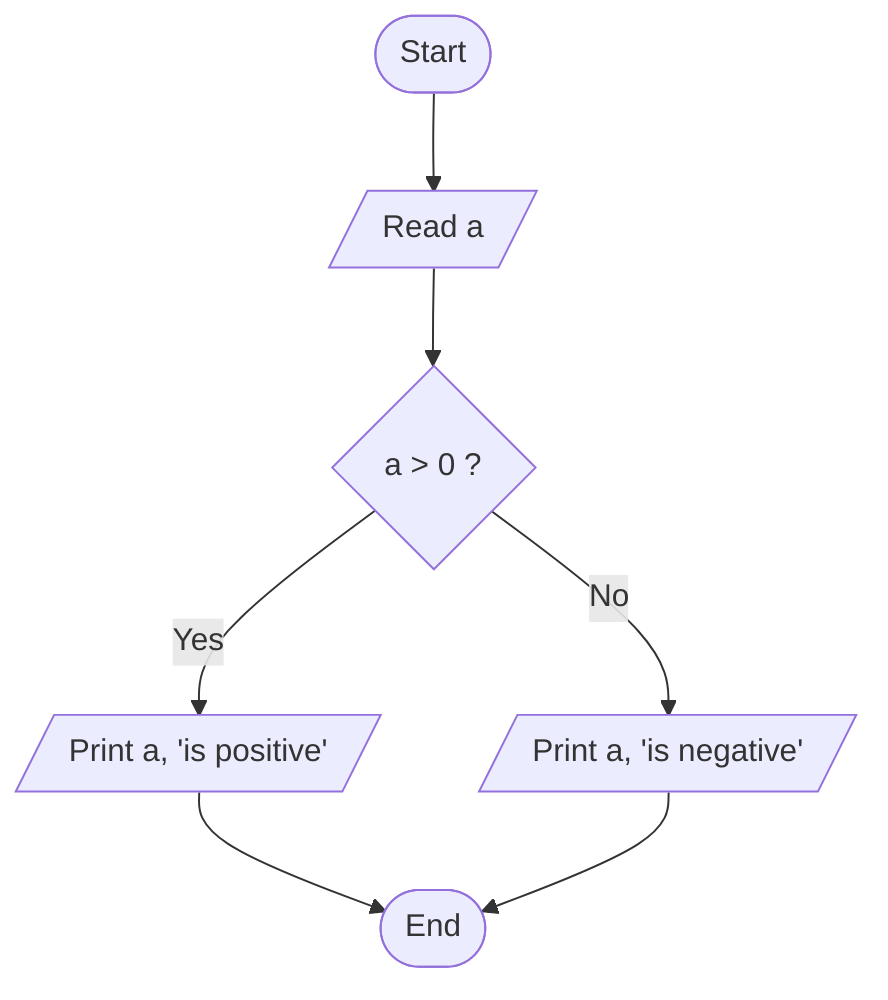
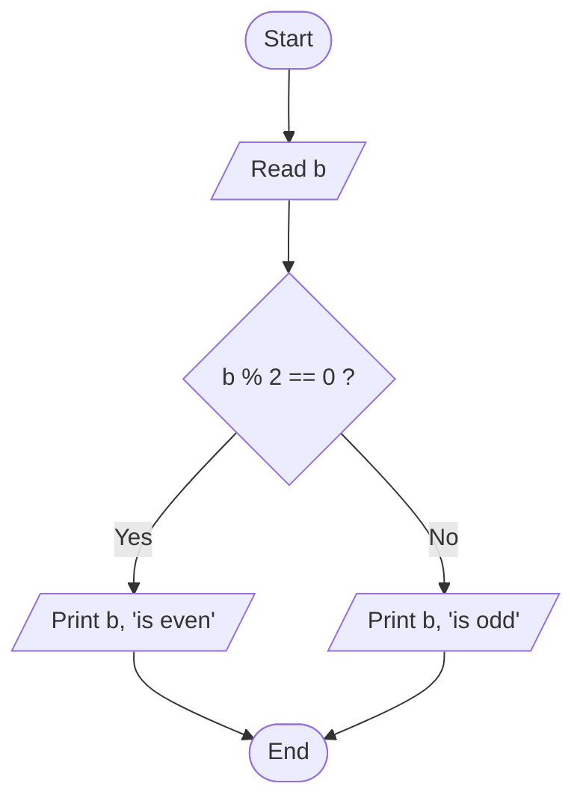
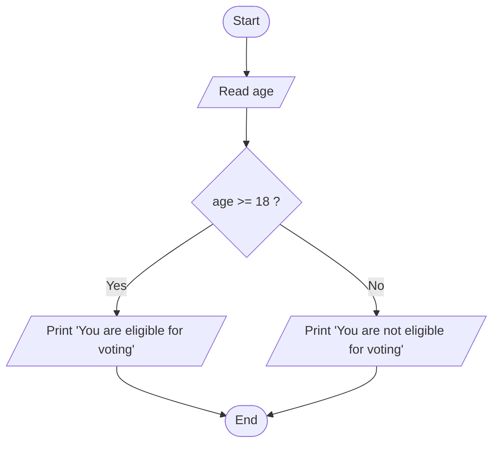
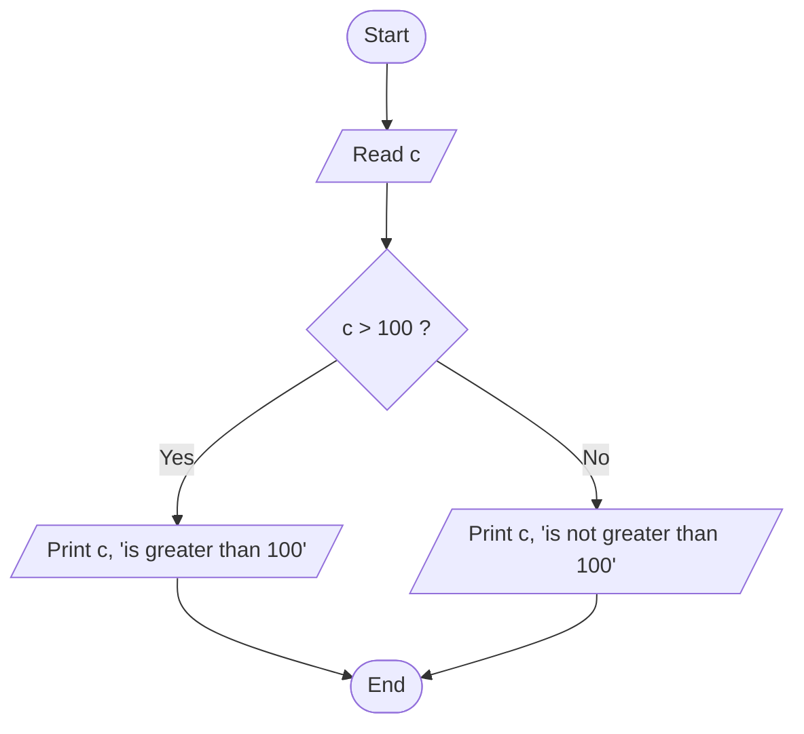
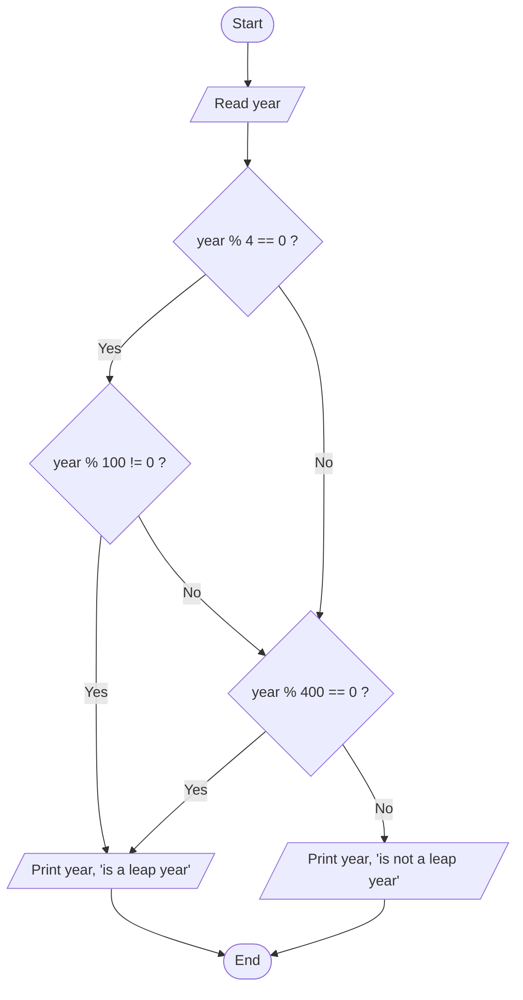

# Assignment 1 – Dry Runs and Visual Walkthroughs

A **dry run** means executing a program by hand, line by line, and writing down the value of each variable and the result of each condition. Every program below has:

1. A **flowchart** showing every path the program can take.
2. A **trace table** for one or more sample inputs.

> The flowcharts use [Mermaid](https://mermaid.js.org/). They render as diagrams on GitHub and in Cursor / VS Code's Markdown preview.

---

## Q1 – Positive or Negative ([`q1.py`](q1.py))

### Flowchart



### Trace Table

| Step | Line | `a` | Condition `a > 0` | Output |
|------|------|-----|-------------------|--------|
| 1 | `a = int(input(...))` | 7 | – | – |
| 2 | `if a > 0:` | 7 | **True** | – |
| 3 | `print(a)` / `print(" is positive")` | 7 | – | `7` / ` is positive` |

| Input `a` | `a > 0` | Branch taken | Output |
|-----------|---------|--------------|--------|
| 7 | True | `if` | is positive |
| -3 | False | `else` | is negative |
| 0 | False | `else` | is negative |

---

## Q2 – Odd or Even ([`q2.py`](q2.py))

### Flowchart



### Trace Table

| Input `b` | `b % 2` | `b % 2 == 0` | Output |
|-----------|---------|--------------|--------|
| 8 | 0 | True | 8 is even |
| 15 | 1 | False | 15 is odd |

### How `%` Decides

```text
 8 ÷ 2 = 4 remainder 0   →  even
15 ÷ 2 = 7 remainder 1   →  odd
```

---

## Q3 – Voting Eligibility ([`q3.py`](q3.py))

### Flowchart



### Trace Table

| Input `age` | `age >= 18` | Output |
|-------------|-------------|--------|
| 20 | True | You are eligible for voting |
| 18 | True | You are eligible for voting |
| 16 | False | You are not eligible for voting |

### Number Line

```text
  not eligible          |        eligible
 ───────────────────────┼─────────────────────►  age
  0 ...  16  17         18   19   20 ...
```

---

## Q4 – Greater Than 100 ([`q4.py`](q4.py))

### Flowchart



### Trace Table

| Input `c` | `c > 100` | Output |
|-----------|-----------|--------|
| 150 | True | 150 is greater than 100 |
| 100 | False | 100 is not greater than 100 |
| 45 | False | 45 is not greater than 100 |

---

## Q5 – Leap Year ([`q5.py`](q5.py))

### Flowchart

The single compound condition `year % 4 == 0 and year % 100 != 0 or year % 400 == 0` is expanded below into the individual checks Python makes.



### Trace Table

| Input `year` | `year % 4 == 0` | `year % 100 != 0` | Left part (`and`) | `year % 400 == 0` | Final (`or`) | Output |
|--------------|-----------------|-------------------|-------------------|-------------------|--------------|--------|
| 2024 | True | True | **True** | False | **True** | is a leap year |
| 1900 | True | False | False | False | **False** | is not a leap year |
| 2000 | True | False | False | True | **True** | is a leap year |
| 2023 | False | True | False | False | **False** | is not a leap year |

### Set View of Leap Years

```text
┌──────────── divisible by 4 ─────────────┐
│   2024, 2028 ...  → LEAP                │
│   ┌──────── divisible by 100 ────────┐  │
│   │   1900, 2100 ...  → NOT leap     │  │
│   │   ┌──── divisible by 400 ────┐   │  │
│   │   │  2000, 2400 ... → LEAP   │   │  │
│   │   └──────────────────────────┘   │  │
│   └──────────────────────────────────┘  │
└─────────────────────────────────────────┘
  Everything outside the outer box (2023, 2025 ...) → NOT leap
```
