# Assignment 2 – Dry Runs and Visual Walkthroughs

A **dry run** means executing a program by hand, line by line, and writing down the value of each variable and the result of each condition. Every program below has:

1. A **flowchart** showing every path the program can take.
2. A **trace table** following the sample input from [OUTPUTS.md](OUTPUTS.md).
3. A **chart or diagram** showing how the final amount is built up.

> The flowcharts and charts use [Mermaid](https://mermaid.js.org/). They render as diagrams on GitHub and in Cursor / VS Code's Markdown preview.

---

## Q1 – Electricity Bill ([`q1.py`](q1.py))

### Flowchart

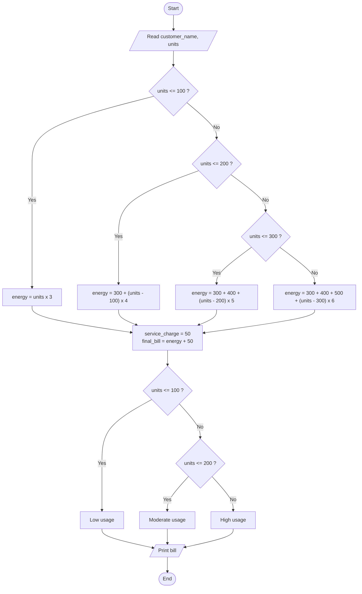

### Trace Table – Ravi, 250 units

| Step | Statement / Condition | Result | `energy_charge` | `final_bill` | `usage_message` |
|------|-----------------------|--------|-----------------|--------------|-----------------|
| 1 | `units = 250` | – | – | – | – |
| 2 | `units <= 100` | False | – | – | – |
| 3 | `units <= 200` | False | – | – | – |
| 4 | `units <= 300` | **True** | 300 + 400 + 50 × 5 = **950** | – | – |
| 5 | `final_bill = 950 + 50` | – | 950 | **1000** | – |
| 6 | `units <= 100` / `units <= 200` | False / False | 950 | 1000 | **High electricity usage** |

### Slab Breakdown

```text
Units:   1 ──────── 100 ──────── 200 ──── 250
Rate:      ₹3/unit      ₹4/unit    ₹5/unit
Cost:      100×3=300    100×4=400  50×5=250   → Energy = 950
```

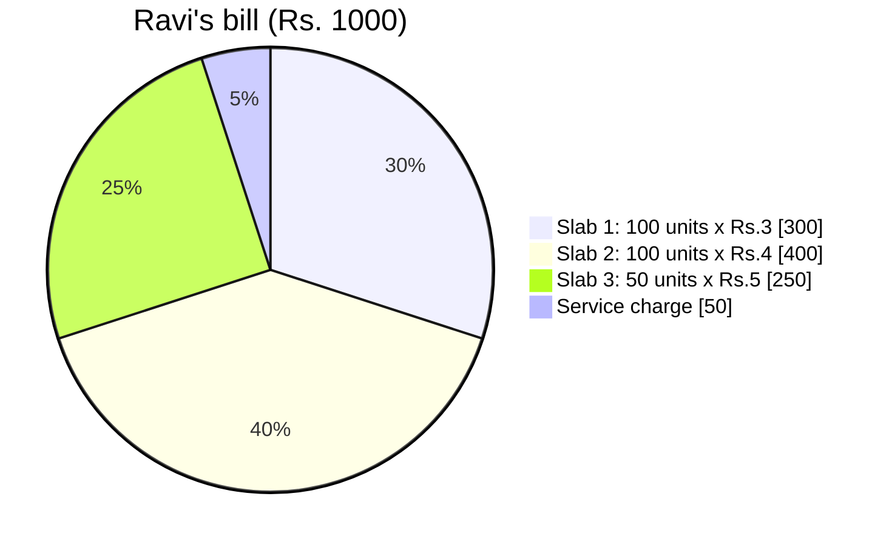

---

## Q2 – Shopping Checkout ([`q2.py`](q2.py))

### Flowchart

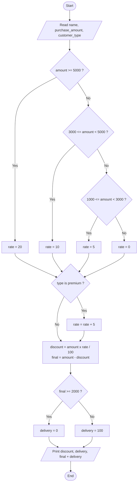

### Trace Table

| Variable / Check | Priya (5500, Premium) | Amit (1500, Regular) |
|------------------|-----------------------|----------------------|
| `amount >= 5000` | True → rate 20 | False |
| `3000 <= amount < 5000` | – | False |
| `1000 <= amount < 3000` | – | True → rate 5 |
| Premium? | Yes → rate **25** | No → rate **5** |
| `discount_amount` | 5500 × 25 / 100 = **1375.0** | 1500 × 5 / 100 = **75.0** |
| `final_amount` | 4125.0 | 1425.0 |
| `final_amount >= 2000` | True → delivery **0** | False → delivery **100** |
| `final_payable` | **4125.0** | **1525.0** |

### Where Priya's ₹5500 Goes

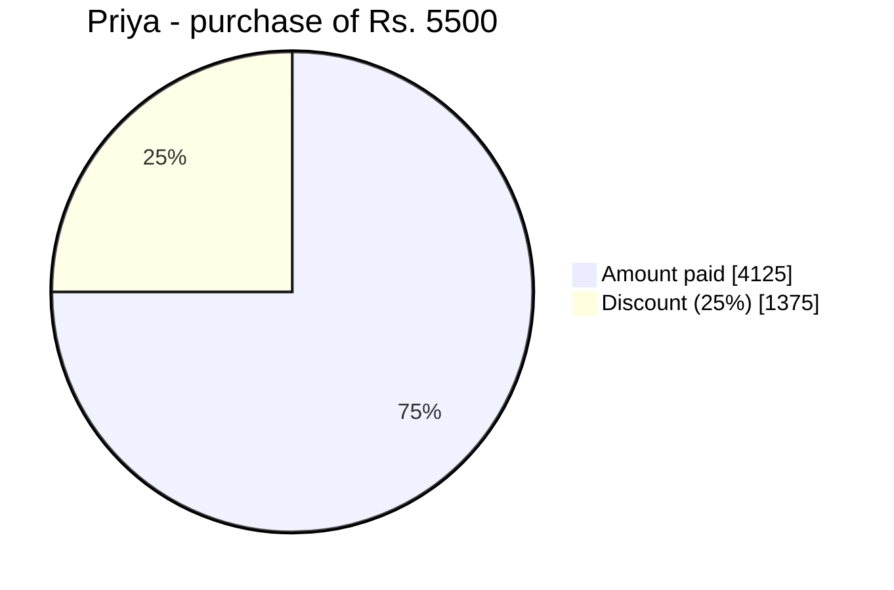

---

## Q3 – ATM Transaction ([`q3.py`](q3.py))

### Flowchart

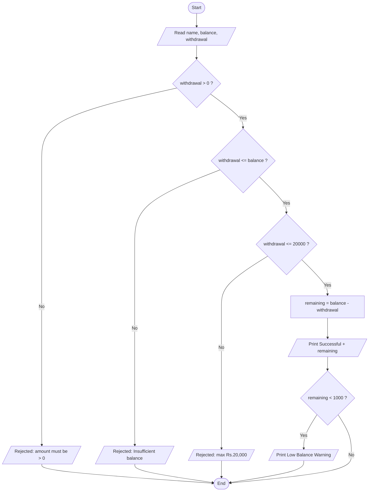

### Trace Table

| Check | Rahul (15000, 14500) | Sneha (5000, 8000) | Kiran (50000, 25000) |
|-------|----------------------|--------------------|----------------------|
| `withdrawal > 0` | True | True | True |
| `withdrawal <= balance` | True | **False** | True |
| `withdrawal <= 20000` | True | – | **False** |
| `remaining_balance` | 500.0 | – | – |
| `remaining < 1000` | True | – | – |
| Result | Successful + Low Balance Warning | Rejected – Insufficient balance | Rejected – limit ₹20,000 |

### Gate View

Each request must pass every gate in order; the first gate it fails decides the rejection reason.

```text
 request ──► [ > 0 ? ] ──► [ ≤ balance ? ] ──► [ ≤ 20000 ? ] ──► SUCCESS ──► [ remaining < 1000 ? ] ──► warning
                 │               │                  │
              reject          reject             reject
```

---

## Q4 – Scholarship Eligibility ([`q4.py`](q4.py))

### Flowchart

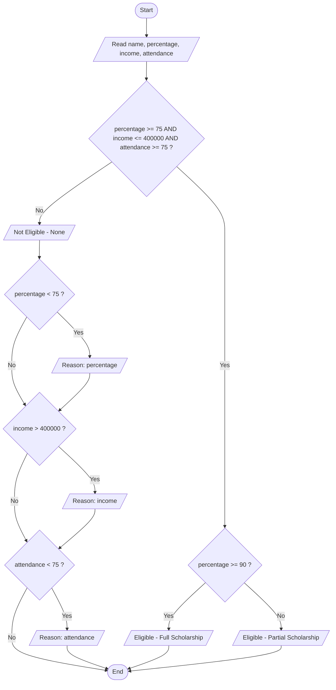

### Trace Table

| Check | Meera (92, 3,00,000, 85) | Arjun (70, 5,00,000, 60) |
|-------|--------------------------|--------------------------|
| `percentage >= 75` | True | False |
| `income <= 400000` | True | False |
| `attendance >= 75` | True | False |
| All three (`and`) | **True** | **False** |
| `percentage >= 90` | True → Full Scholarship | – |
| Reasons printed | – | Percentage, Income, Attendance |

Because the three reason checks are separate `if` statements (not `elif`), **every** failed criterion is reported, not just the first one.

---

## Q5 – Employee Bonus ([`q5.py`](q5.py))

### Flowchart

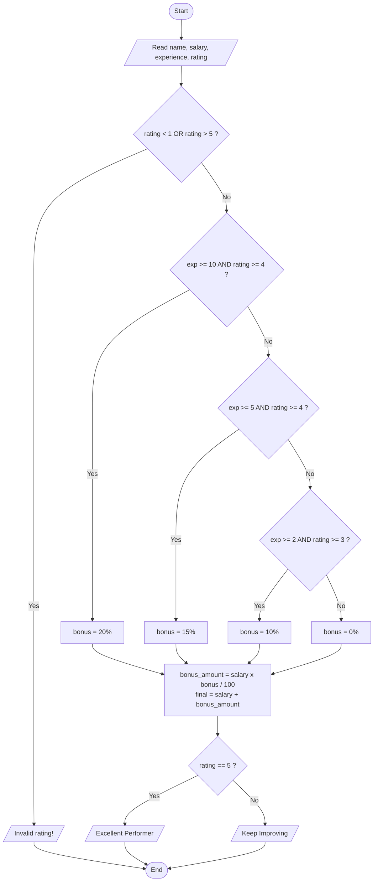

### Trace Table

| Check | Vikram (60000, 12 yrs, 5) | Neha (40000, 3 yrs, 3) | Karan (30000, 5 yrs, 7) |
|-------|---------------------------|------------------------|-------------------------|
| Rating invalid? | False | False | **True** → stop |
| `exp >= 10 and rating >= 4` | **True** → 20% | False | – |
| `exp >= 5 and rating >= 4` | – | False | – |
| `exp >= 2 and rating >= 3` | – | **True** → 10% | – |
| `bonus_amount` | 12000.0 | 4000.0 | – |
| `final_salary` | 72000.0 | 44000.0 | – |
| Message | Excellent Performer | Keep Improving | Invalid rating! |

### Bonus Matrix

| Experience ↓ / Rating → | 1–2 | 3 | 4–5 |
|-------------------------|-----|---|-----|
| 0–1 years | 0% | 0% | 0% |
| 2–4 years | 0% | 10% | 10% |
| 5–9 years | 0% | 10% | 15% |
| 10+ years | 0% | 10% | 20% |

---

## Q6 – Hotel Booking ([`q6.py`](q6.py))

### Flowchart

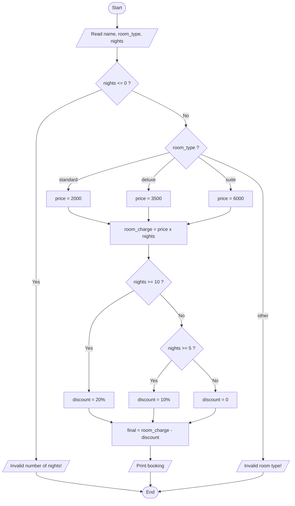

### Trace Table

| Variable / Check | Rohan (Deluxe, 6) | Sara (Suite, 12) |
|------------------|-------------------|------------------|
| `price` | 3500 | 6000 |
| `room_charge` | 3500 × 6 = 21000 | 6000 × 12 = 72000 |
| `nights >= 10` | False | **True** → 20% |
| `nights >= 5` | **True** → 10% | – |
| `discount` | 2100.0 | 14400.0 |
| `final_amount` | **18900.0** | **57600.0** |

### Room Charge vs Final Amount

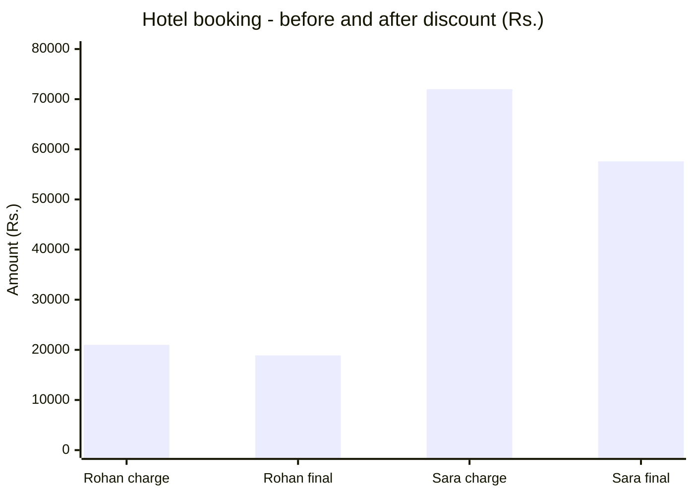

---

## Q7 – Mobile Data Plan Bill ([`q7.py`](q7.py))

### Flowchart

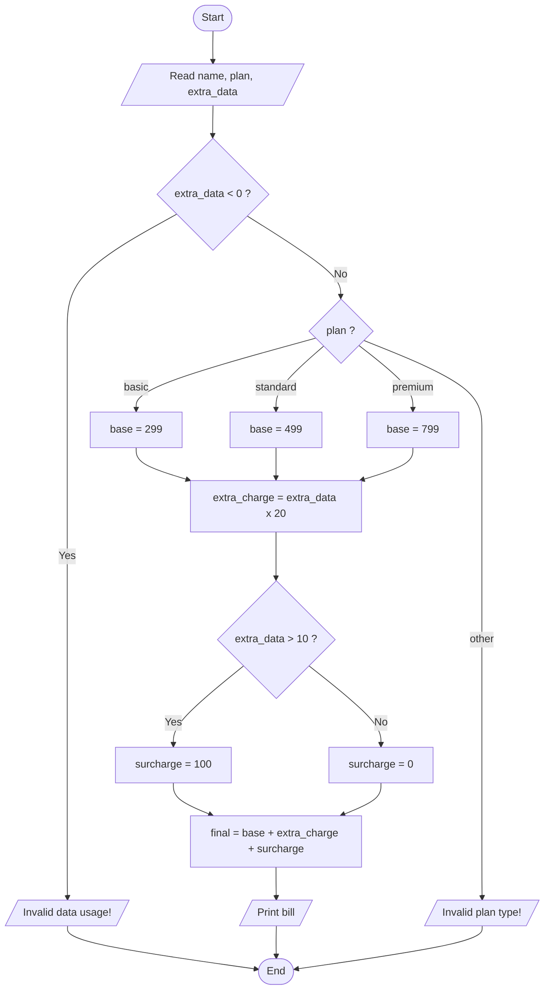

### Trace Table

| Variable / Check | Ajay (Premium, 12 GB) | Pooja (Basic, 4 GB) |
|------------------|-----------------------|---------------------|
| `base_charge` | 799 | 299 |
| `extra_charge` | 12 × 20 = 240.0 | 4 × 20 = 80.0 |
| `extra_data > 10` | True → 100 | False → 0 |
| `final_bill` | 799 + 240 + 100 = **1139.0** | 299 + 80 + 0 = **379.0** |

### Ajay's Bill Breakdown

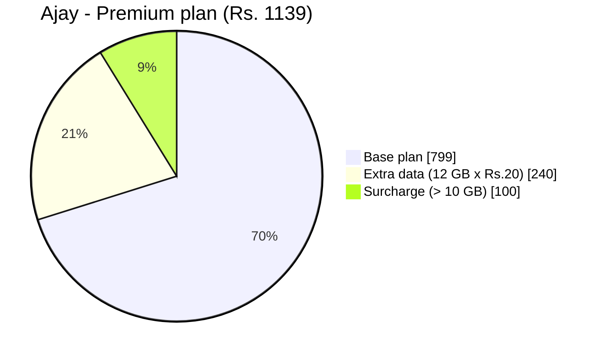

---

## Q8 – Movie Ticket ([`q8.py`](q8.py))

### Flowchart

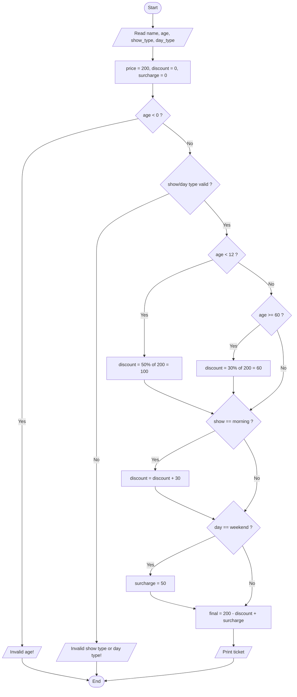

### Trace Table

| Step | Riya (8, Morning, Weekend) | Mohan (65, Evening, Weekday) |
|------|----------------------------|------------------------------|
| Start | price 200, discount 0, surcharge 0 | price 200, discount 0, surcharge 0 |
| Age rule | age < 12 → discount **100.0** | age ≥ 60 → discount **60.0** |
| Morning? | Yes → discount **130.0** | No → 60.0 |
| Weekend? | Yes → surcharge **50** | No → surcharge 0 |
| `final_price` | 200 − 130 + 50 = **120.0** | 200 − 60 + 0 = **140.0** |

### Price Waterfall for Riya

```text
Base price          ₹200  ████████████████████
Child discount     −₹100  ██████████
Morning discount    −₹30  ███
Weekend surcharge   +₹50  █████
───────────────────────────────────────────────
Final price         ₹120  ████████████
```

---

## Q9 – Insurance Premium ([`q9.py`](q9.py))

### Flowchart

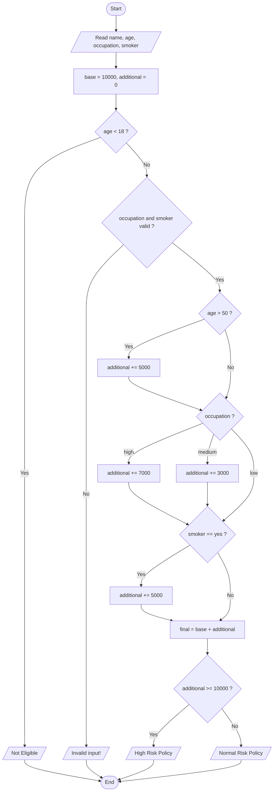

### Trace Table – Suresh (55, High, Smoker)

| Step | Check | Result | `additional_charges` |
|------|-------|--------|----------------------|
| 1 | Initial | – | 0 |
| 2 | `age < 18` | False | 0 |
| 3 | `age > 50` | True | 5000 |
| 4 | `occupation == "high"` | True | 12000 |
| 5 | `smoker == "yes"` | True | 17000 |
| 6 | `final_premium = 10000 + 17000` | – | **27000** |
| 7 | `additional >= 10000` | True | High Risk Policy |

Anjali (30, Low, Non-smoker) passes every check without adding anything, so her premium stays at **₹10,000** with a *Normal Risk Policy*. Tom (16) stops at step 2 with *Not Eligible*.

### Premium Composition for Suresh

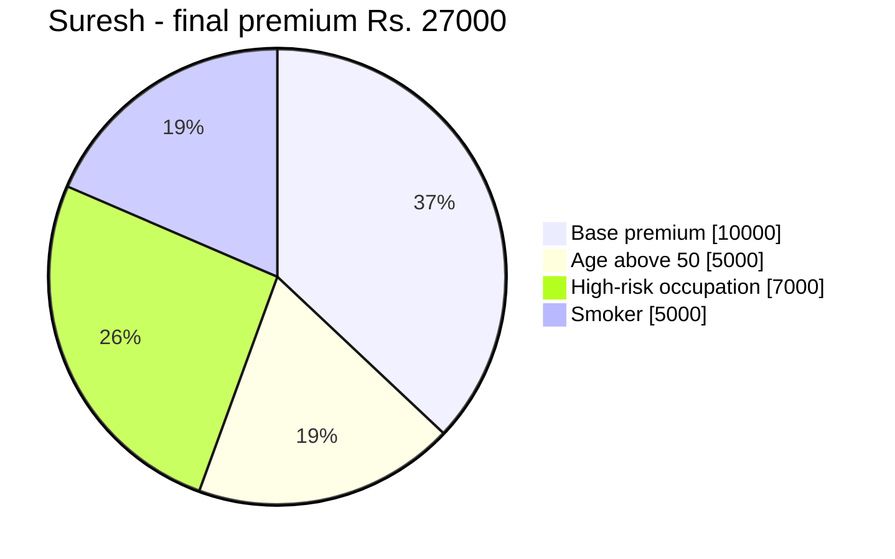

---

## Q10 – Restaurant Bill ([`q10.py`](q10.py))

### Flowchart

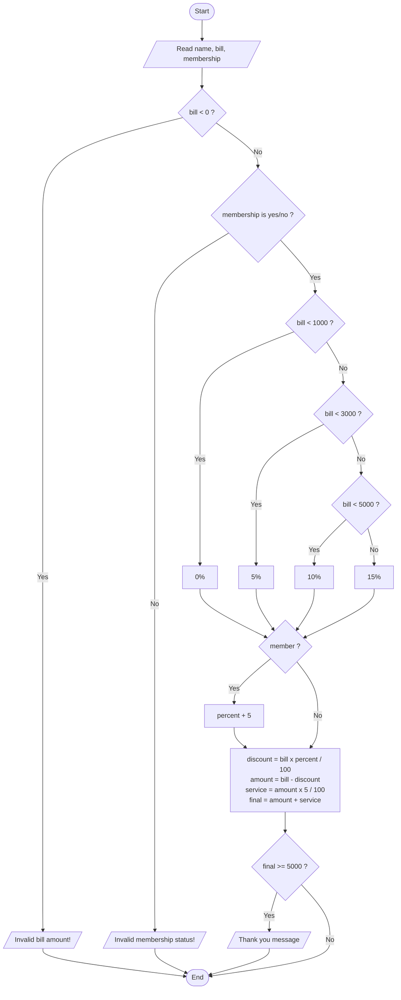

### Trace Table

| Variable / Check | Kunal (6000, member) | Divya (800, non-member) |
|------------------|----------------------|-------------------------|
| Slab | bill ≥ 5000 → 15% | bill < 1000 → 0% |
| Member bonus | +5% → **20%** | none → **0%** |
| `discount` | 6000 × 20 / 100 = 1200.0 | 0.0 |
| `amount` | 4800.0 | 800.0 |
| `service_charge` | 4800 × 5 / 100 = 240.0 | 800 × 5 / 100 = 40.0 |
| `final_bill` | **5040.0** | **840.0** |
| `final_bill >= 5000` | True → thank-you message | False |

### Kunal's Bill Flow

```text
Original bill   ₹6000
  − 20% discount  ₹1200   →  ₹4800
  + 5% service    ₹240    →  ₹5040   (≥ ₹5000 → "Thank you for being a valued customer")
```
