# Assignment 4 – Dry Runs and Visual Walkthroughs

A **dry run** means executing a program by hand, line by line, and writing down the value of each variable after every step. For loop programs, the most useful dry run is an **iteration table**: one row per pass through the loop, showing how the counters and totals change.

Every program below has:

1. A **flowchart** showing the loop and its exit conditions.
2. An **iteration table** following the sample input from [OUTPUTS.md](OUTPUTS.md).
3. A **chart or diagram** visualising the data the loop processed.

> The flowcharts and charts use [Mermaid](https://mermaid.js.org/). They render as diagrams on GitHub and in Cursor / VS Code's Markdown preview.

---

## Q1 – Daily Expense Tracker ([`q1.py`](q1.py))

### Flowchart

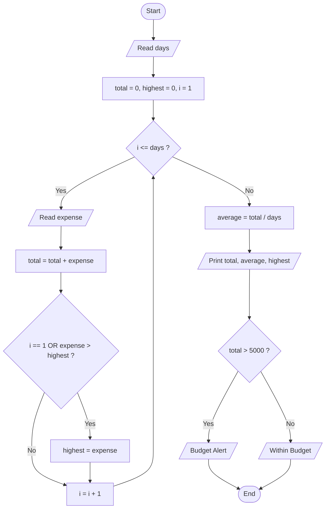

### Iteration Table (5 days)

| `i` | `expense` | `total` (after) | `expense > highest` ? | `highest` (after) |
|-----|-----------|-----------------|-----------------------|-------------------|
| 1 | 800 | 800 | first day | 800 |
| 2 | 1200 | 2000 | 1200 > 800 ✔ | 1200 |
| 3 | 950 | 2950 | 950 > 1200 ✘ | 1200 |
| 4 | 1500 | 4450 | 1500 > 1200 ✔ | 1500 |
| 5 | 1100 | 5550 | 1100 > 1500 ✘ | 1500 |

After the loop: `average = 5550 / 5 = 1110.0`; `5550 > 5000` → **Budget Alert**.

### Daily Expenses

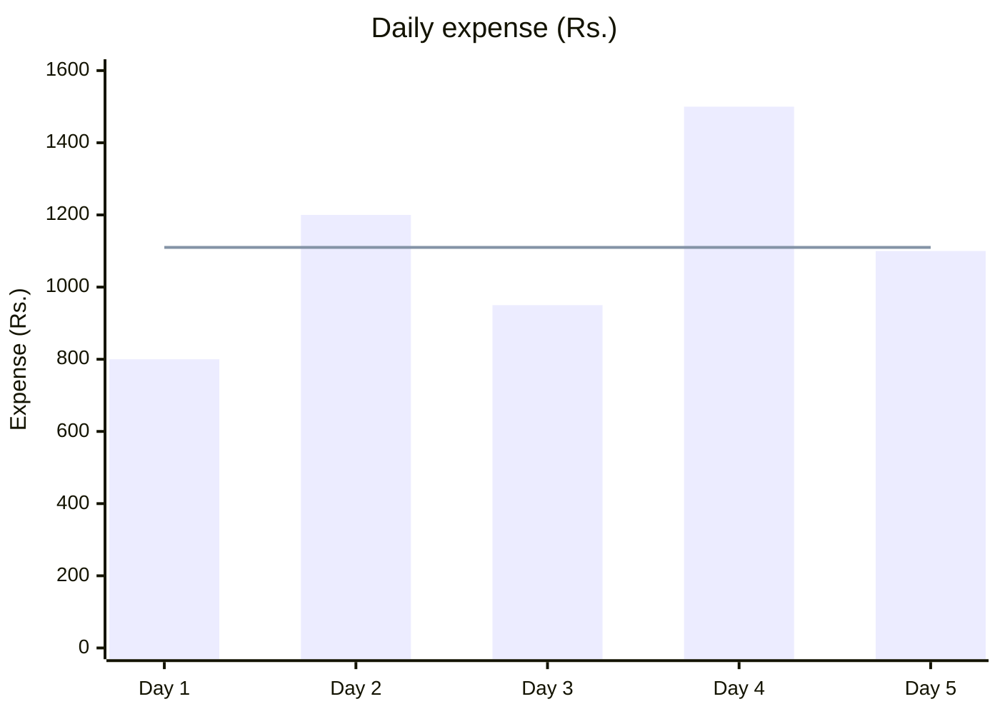

The bars are the daily expenses and the flat line is the average (₹1110).

### Running Total vs Budget

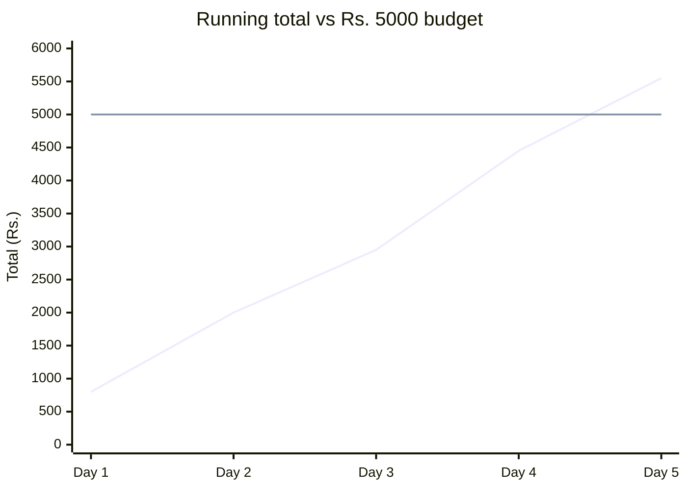

The running total crosses the ₹5000 budget line on day 5, which triggers the alert.

---

## Q2 – Class Grade Calculator ([`q2.py`](q2.py))

### Flowchart

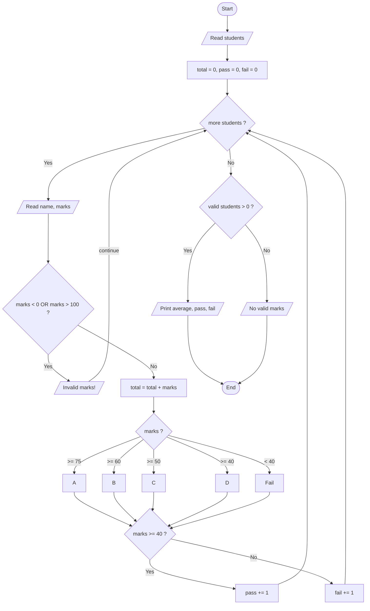

### Iteration Table (4 students)

| Iteration | Name | Marks | Valid? | Grade | `total` | `pass_count` | `fail_count` |
|-----------|------|-------|--------|-------|---------|--------------|--------------|
| 1 | Aman | 82 | ✔ | A | 82 | 1 | 0 |
| 2 | Bela | 65 | ✔ | B | 147 | 2 | 0 |
| 3 | Chirag | 35 | ✔ | Fail | 182 | 2 | 1 |
| 4 | Dev | 120 | ✘ → `continue` | – | 182 | 2 | 1 |

After the loop: `valid_students = 2 + 1 = 3`, `average = 182 / 3 = 60.67`.

### Grade Bands

```text
Marks:  0 ────────── 40 ──── 50 ──── 60 ──────── 75 ────────── 100
Grade:      Fail      │  D   │  C   │     B      │      A
                      ▲                          ▲
                   Chirag (35)        Bela (65)  │   Aman (82)
```

### Pass / Fail Split

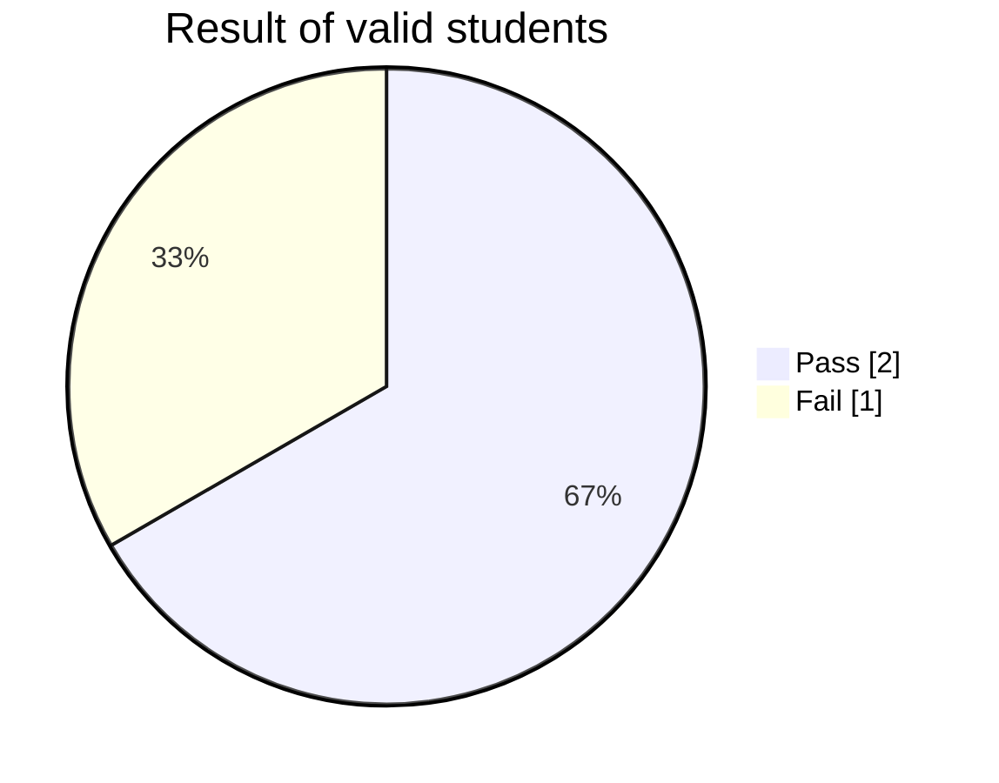

---

## Q3 – ATM PIN Verification ([`q3.py`](q3.py))

### Flowchart

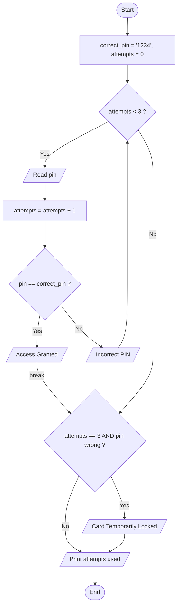

### Iteration Tables

**Run 1 – PINs `1111`, `1234`**

| Pass | `pin` | `attempts` | `pin == "1234"` | Action |
|------|-------|------------|-----------------|--------|
| 1 | 1111 | 1 | False | Incorrect PIN |
| 2 | 1234 | 2 | **True** | Access Granted → `break` |

Lock check: `attempts == 3` is False → no lock. Output: *Attempts Used: 2*.

**Run 2 – PINs `0000`, `1111`, `2222`**

| Pass | `pin` | `attempts` | `pin == "1234"` | Action |
|------|-------|------------|-----------------|--------|
| 1 | 0000 | 1 | False | Incorrect PIN |
| 2 | 1111 | 2 | False | Incorrect PIN |
| 3 | 2222 | 3 | False | Incorrect PIN |
| – | – | 3 | `attempts < 3` is False | loop ends |

Lock check: `attempts == 3 and pin != "1234"` is True → **Card Temporarily Locked**.

---

## Q4 – Shopping Cart ([`q4.py`](q4.py))

### Flowchart

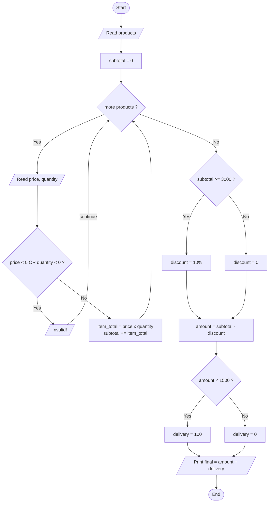

### Iteration Table (3 products)

| Product | `price` | `quantity` | `item_total` | `subtotal` (after) |
|---------|---------|------------|--------------|--------------------|
| 1 | 500 | 2 | 1000.0 | 1000.0 |
| 2 | 1200 | 1 | 1200.0 | 2200.0 |
| 3 | 250 | 4 | 1000.0 | 3200.0 |

After the loop:

| Step | Check | Result |
|------|-------|--------|
| Discount | `3200 >= 3000` → True | 3200 × 10 / 100 = **320.0** |
| Amount | 3200 − 320 | **2880.0** |
| Delivery | `2880 < 1500` → False | **0** |
| Final | 2880 + 0 | **2880.0** |

### Cart Composition

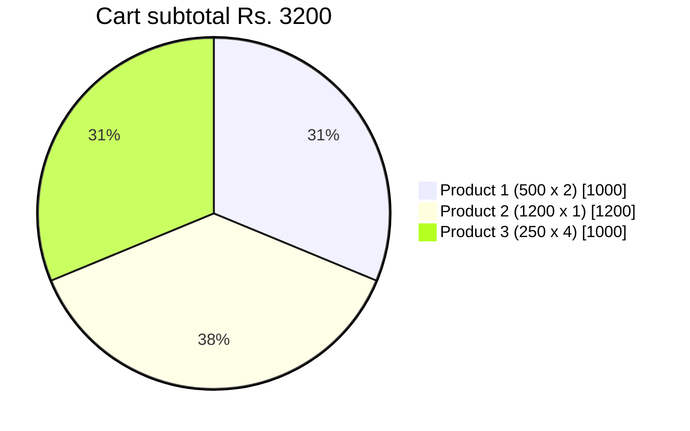

---

## Q5 – Number Guessing Game ([`q5.py`](q5.py))

### Flowchart

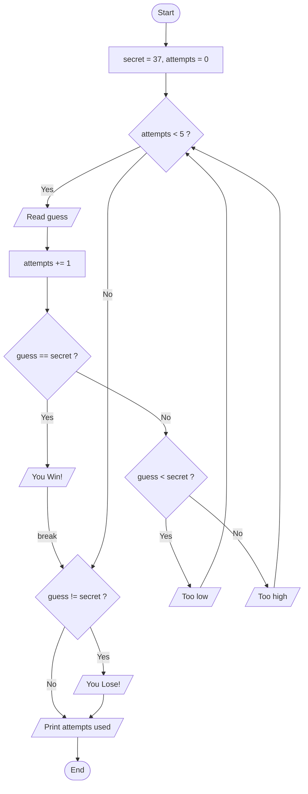

### Iteration Table – Run 1 (win)

| Pass | `guess` | `attempts` | Comparison with 37 | Output |
|------|---------|------------|--------------------|--------|
| 1 | 50 | 1 | 50 > 37 | Too high |
| 2 | 20 | 2 | 20 < 37 | Too low |
| 3 | 37 | 3 | equal | You Win! → `break` |

### How the Hints Narrow the Range

```text
Guess 1 = 50 → "Too high"   possible range: 1 ─────────────── 49
Guess 2 = 20 → "Too low"    possible range:        21 ─────── 49
Guess 3 = 37 → "You Win!"                              ▲ 37
```

### Iteration Table – Run 2 (lose)

| Pass | `guess` | `attempts` | Hint |
|------|---------|------------|------|
| 1 | 10 | 1 | Too low |
| 2 | 20 | 2 | Too low |
| 3 | 30 | 3 | Too low |
| 4 | 40 | 4 | Too high |
| 5 | 50 | 5 | Too high |

The loop ends because `attempts < 5` is False, and `50 != 37` prints **You Lose! The secret number was 37**.

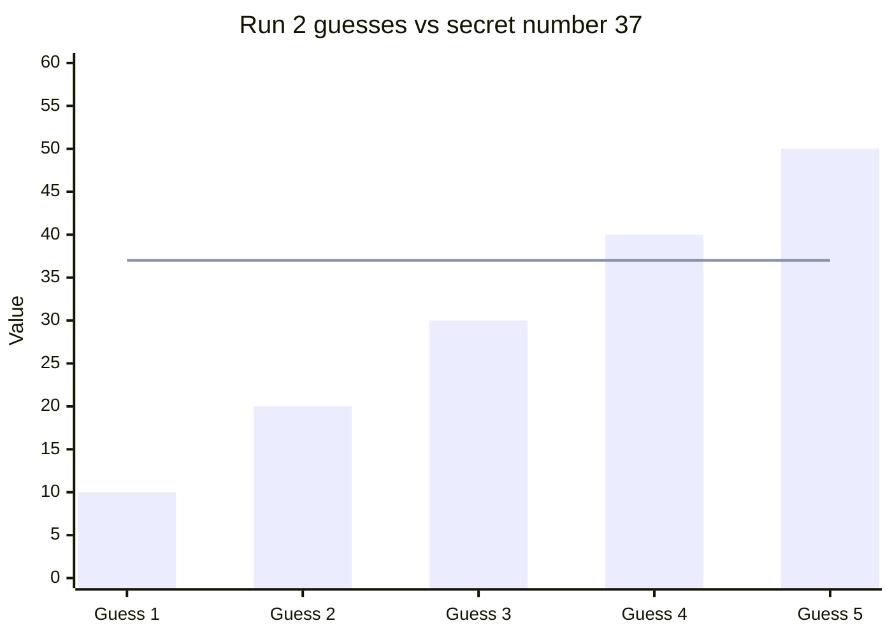

---

## Q6 – Electricity Usage Analyser ([`q6.py`](q6.py))

### Flowchart

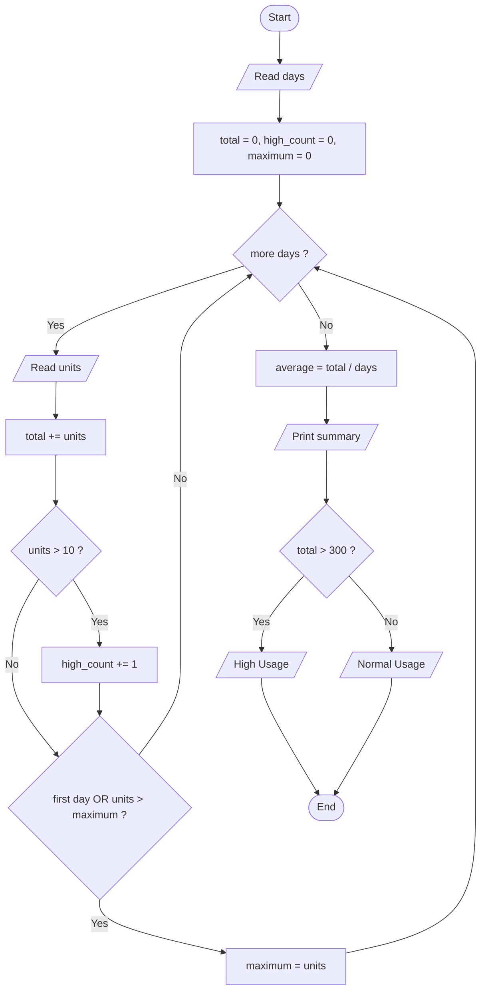

### Iteration Table (7 days)

| Day | `units` | `total` | `units > 10` ? | `high_count` | `maximum` |
|-----|---------|---------|----------------|--------------|-----------|
| 1 | 8 | 8 | ✘ | 0 | 8 |
| 2 | 12 | 20 | ✔ | 1 | 12 |
| 3 | 9 | 29 | ✘ | 1 | 12 |
| 4 | 15 | 44 | ✔ | 2 | 15 |
| 5 | 10 | 54 | ✘ (10 is not > 10) | 2 | 15 |
| 6 | 11 | 65 | ✔ | 3 | 15 |
| 7 | 7 | 72 | ✘ | 3 | 15 |

After the loop: `average = 72 / 7 ≈ 10.29`; `72 > 300` is False → **Normal Usage**.

### Daily Usage vs High-Usage Threshold

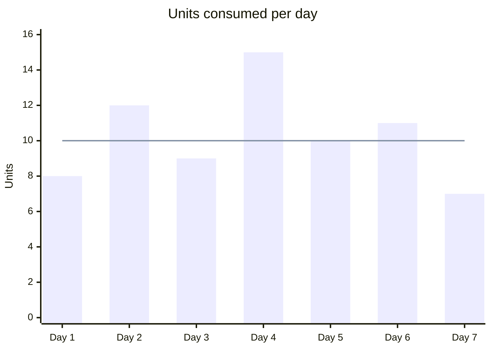

Bars above the line at 10 units (days 2, 4 and 6) are the three high-usage days.

---

## Q7 – Employee Payroll ([`q7.py`](q7.py))

### Flowchart

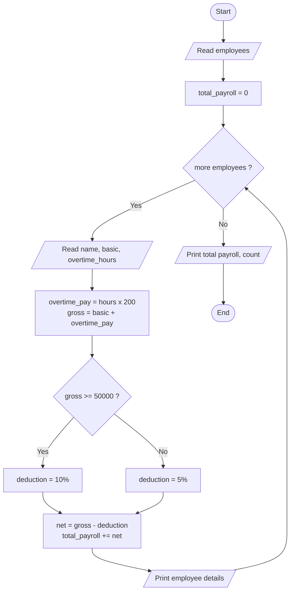

### Iteration Table (2 employees)

| Employee | `basic_salary` | OT hours | `overtime_pay` | `gross_salary` | Rate | `deduction` | `net_salary` | `total_payroll` |
|----------|----------------|----------|----------------|----------------|------|-------------|--------------|-----------------|
| Asha | 45000 | 10 | 2000 | 47000 | 5% | 2350 | 44650 | 44650 |
| Bharat | 52000 | 5 | 1000 | 53000 | 10% | 5300 | 47700 | **92350** |

### Gross vs Net Salary

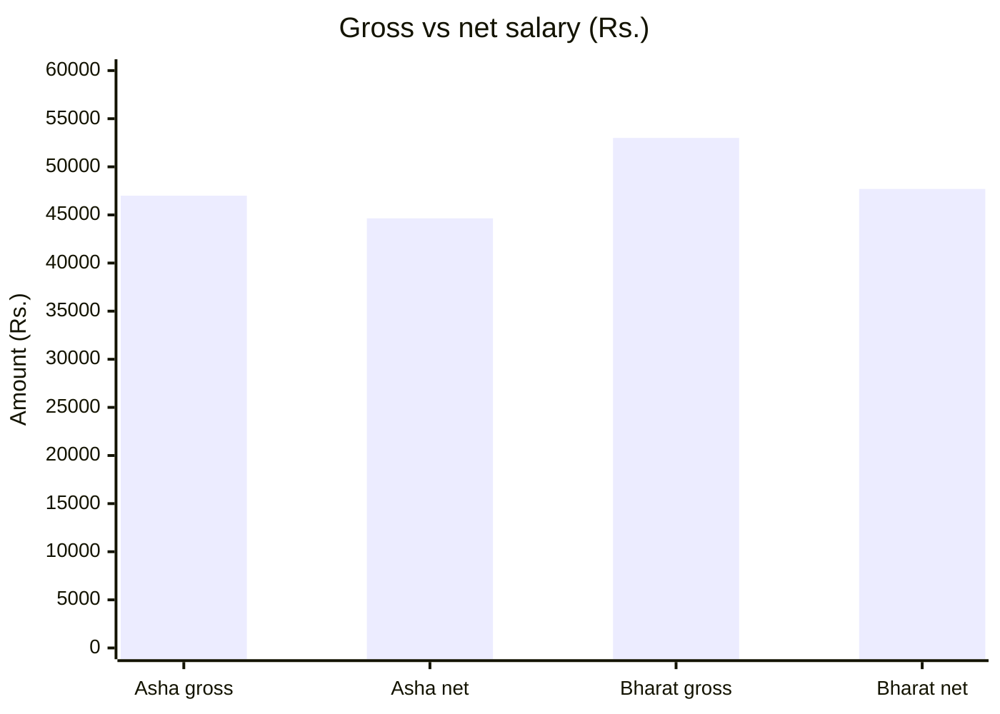

Bharat's gross crosses ₹50,000, so he moves into the 10% deduction bracket.

---

## Q8 – Quiz ([`q8.py`](q8.py))

### Flowchart

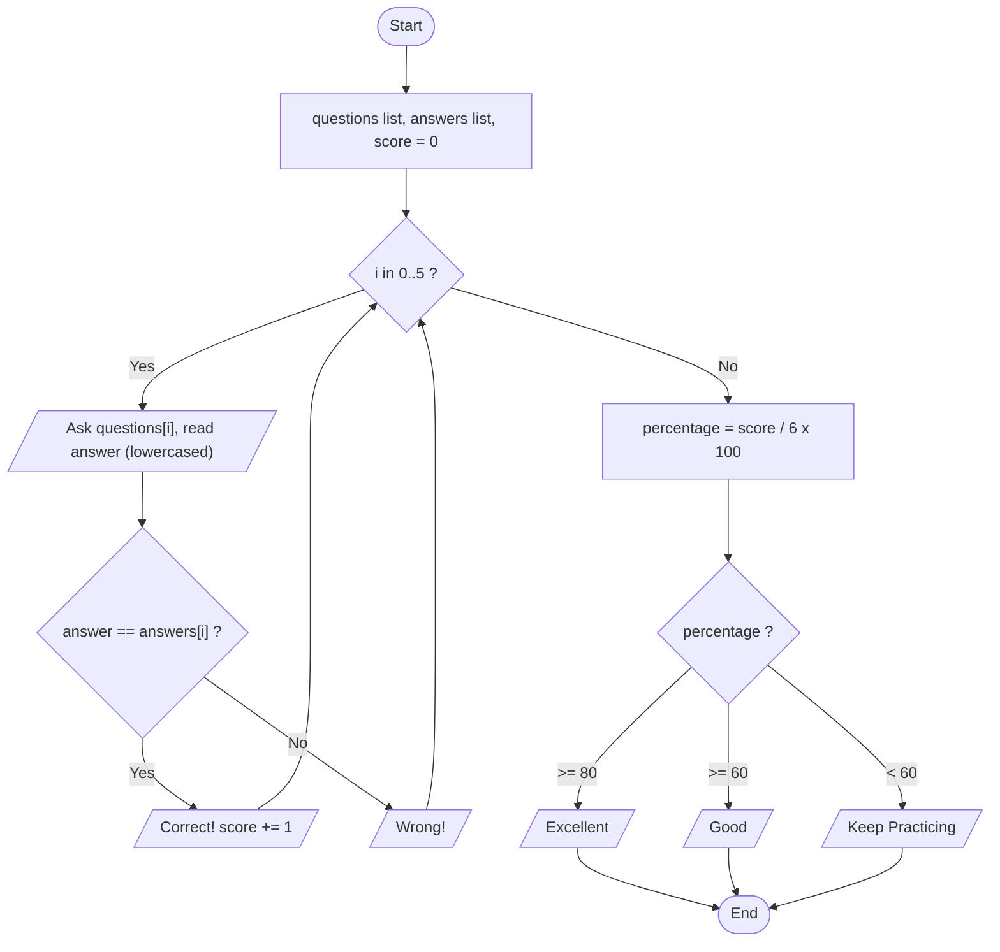

### Iteration Table

| `i` | User answer (lowercased) | `answers[i]` | Match? | `score` |
|-----|--------------------------|--------------|--------|---------|
| 0 | delhi | delhi | ✔ | 1 |
| 1 | 7 | 7 | ✔ | 2 |
| 2 | css | css | ✔ | 3 |
| 3 | 12 | 10 | ✘ | 3 |
| 4 | mars | mars | ✔ | 4 |
| 5 | atlantic | pacific | ✘ | 4 |

After the loop: `percentage = 4 / 6 × 100 = 66.67`; `66.67 >= 80` False, `66.67 >= 60` True → **Good**.

### How the Two Lists Line Up

```text
index:      0         1      2        3      4        5
questions:  capital   week   styling  5+5    red      ocean
answers:    "delhi"   "7"    "css"    "10"   "mars"   "pacific"
user:       "delhi"   "7"    "css"    "12"   "mars"   "atlantic"
result:       ✔        ✔      ✔        ✘      ✔        ✘
```

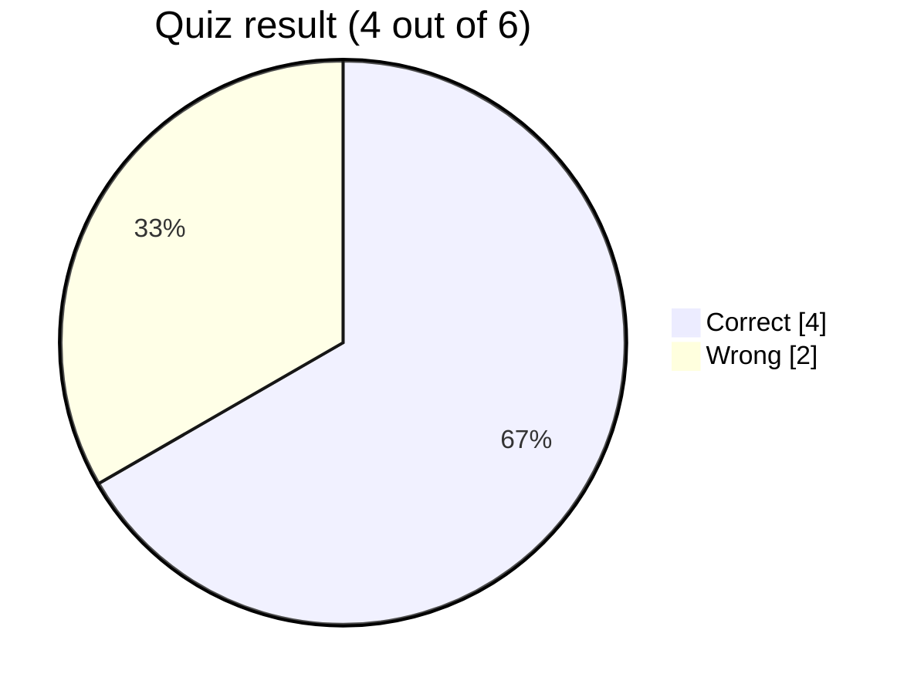

---

## Q9 – Bank Transaction Simulator ([`q9.py`](q9.py))

### Flowchart

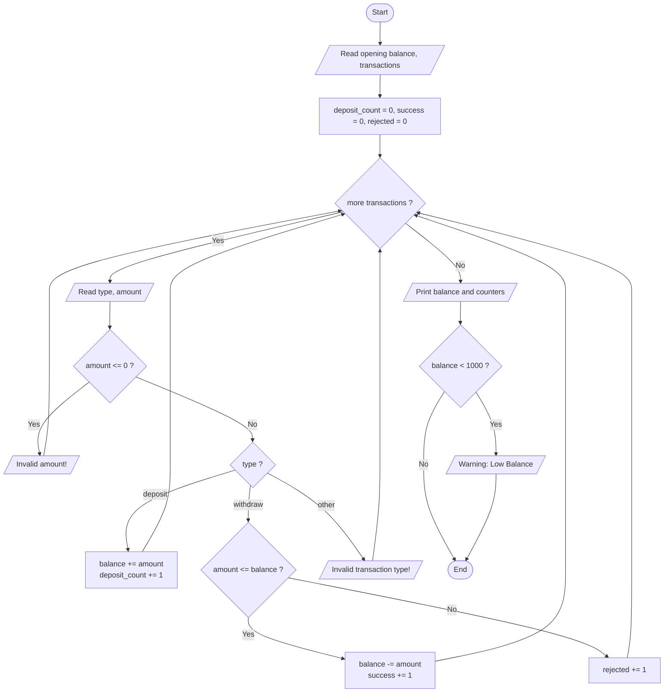

### Iteration Table (opening balance ₹5000)

| Txn | Type | Amount | Check | `balance` (after) | Deposits | Successful W | Rejected W |
|-----|------|--------|-------|-------------------|----------|--------------|------------|
| – | opening | – | – | 5000 | 0 | 0 | 0 |
| 1 | deposit | 2000 | – | 7000 | 1 | 0 | 0 |
| 2 | withdraw | 3000 | 3000 ≤ 7000 ✔ | 4000 | 1 | 1 | 0 |
| 3 | withdraw | 6000 | 6000 ≤ 4000 ✘ | 4000 | 1 | 1 | 1 |
| 4 | withdraw | 3500 | 3500 ≤ 4000 ✔ | 500 | 1 | 2 | 1 |

After the loop: `500 < 1000` → **Warning: Low Balance**.

### Balance Over Time

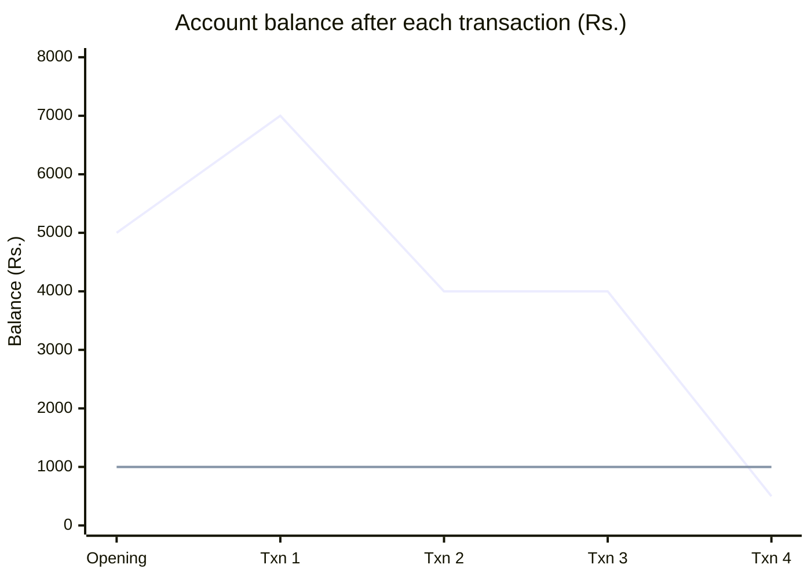

The flat line at ₹1000 is the low-balance threshold. The balance stays level at transaction 3 because that withdrawal was rejected.

---

## Q10 – Multiplication Table and Range Analysis ([`q10.py`](q10.py))

### Flowchart

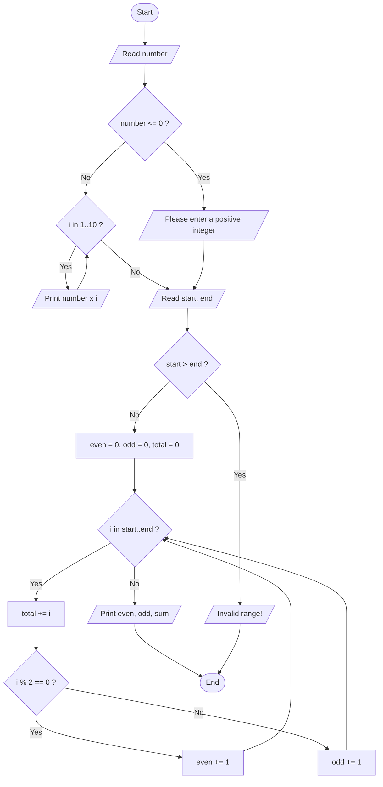

### Part 1 – Multiplication Table of 7

| `i` | 1 | 2 | 3 | 4 | 5 | 6 | 7 | 8 | 9 | 10 |
|-----|---|---|---|---|---|---|---|---|---|----|
| `7 × i` | 7 | 14 | 21 | 28 | 35 | 42 | 49 | 56 | 63 | 70 |

### Part 2 – Range 1 to 10

| `i` | `i % 2` | Even / Odd | `even_count` | `odd_count` | `total` |
|-----|---------|------------|--------------|-------------|---------|
| 1 | 1 | Odd | 0 | 1 | 1 |
| 2 | 0 | Even | 1 | 1 | 3 |
| 3 | 1 | Odd | 1 | 2 | 6 |
| 4 | 0 | Even | 2 | 2 | 10 |
| 5 | 1 | Odd | 2 | 3 | 15 |
| 6 | 0 | Even | 3 | 3 | 21 |
| 7 | 1 | Odd | 3 | 4 | 28 |
| 8 | 0 | Even | 4 | 4 | 36 |
| 9 | 1 | Odd | 4 | 5 | 45 |
| 10 | 0 | Even | 5 | 5 | **55** |

`range(start, end + 1)` is used because Python's `range()` stops **before** its second argument; without the `+ 1`, the number 10 would be skipped.

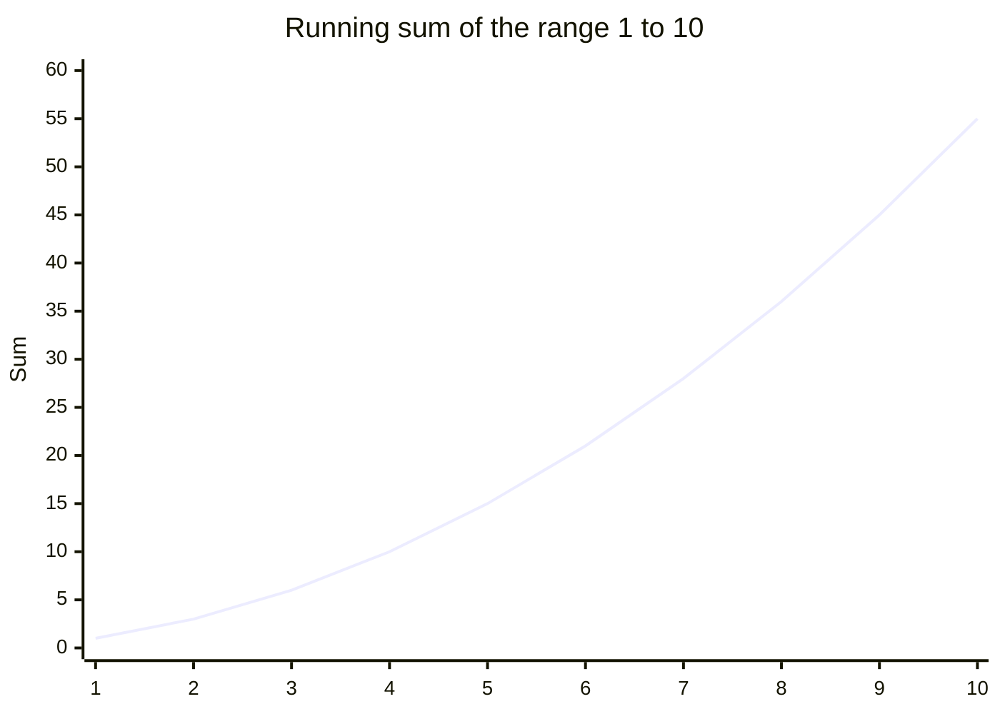
